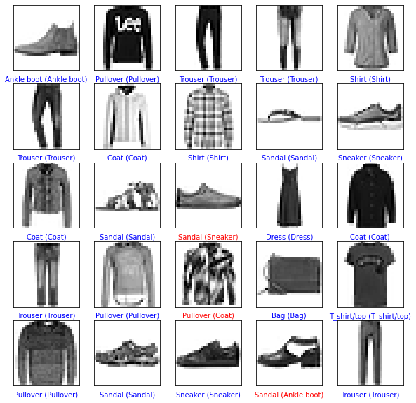
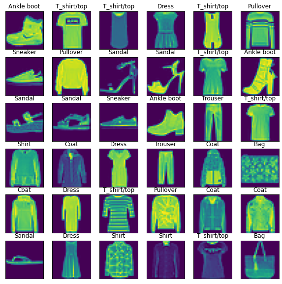
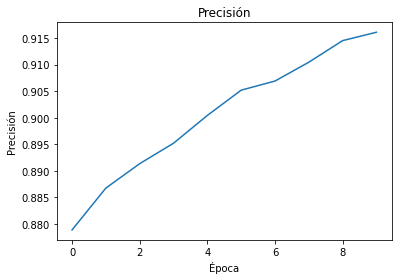

<div align="center">

# Fashion Image Classifier

**A neural network that recognises 10 clothing categories in Zalando's Fashion-MNIST**

<a href="https://colab.research.google.com/github/Steven-Macas/Zalando-Red_Neuronal/blob/main/Zalando_Red_neuronal.ipynb"></a>    


</div>

## Overview

Image classification with **TensorFlow / Keras** on **Fashion-MNIST**, the dataset published by Zalando Research
as a harder replacement for the classic MNIST digits. The notebook covers loading and exploring the images,
normalising them, training a neural network and evaluating it on unseen data.

## Dataset

- **70,000** grayscale images of 28 × 28 pixels: **60,000** for training and **10,000** for testing.
- **10 classes**: T-shirt/top, Trouser, Pullover, Dress, Coat, Sandal, Shirt, Sneaker, Bag and Ankle boot.
- Loaded directly with `keras.datasets.fashion_mnist`.

## Approach

1. Exploration of the images and their labels.
2. Normalisation of pixel values to the 0 – 1 range.
3. Model: `Flatten(28×28)` → `Dense(128, ReLU)` → `Dense(10, softmax)`.
4. Training for 10 epochs with Adam and sparse categorical cross-entropy.
5. Evaluation on the 10,000 test images and visual check of the predictions
   (correct predictions in blue, mistakes in red).

## Results

| Metric | Value |
| --- | --- |
| Training accuracy (epoch 10) | 91.6 % |
| **Test accuracy** | **88.5 %** |
| Test loss | 0.346 |

<table>
  <tr><td align="center" valign="top"><br /><sub>Predictions on test images</sub></td><td align="center" valign="top"><br /><sub>Sample images with their labels</sub></td><td align="center" valign="top"><br /><sub>Accuracy per epoch</sub></td></tr>
</table>

## How to run

Open the notebook in Google Colab with the badge above and run all cells. The dataset downloads automatically.

Locally:

```bash
pip install tensorflow numpy matplotlib jupyter
jupyter notebook Zalando_Red_neuronal.ipynb
```

*The notebook is written in Spanish.*

---

<sub>Made by <b>Steven Macas</b> — Data Engineer &amp; Data Analyst · <a href="https://gointy.com">gointy.com</a> · <a href="https://www.linkedin.com/in/steven-macas">LinkedIn</a> · <a href="https://github.com/Steven-Macas">GitHub</a></sub>
